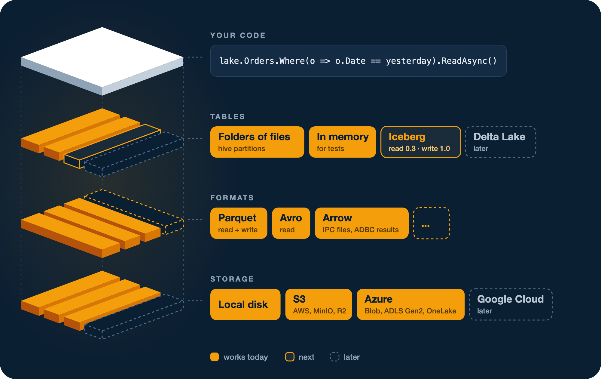

<!-- github-only -->
<p align="center">
  <picture>
    <source media="(prefers-color-scheme: dark)" srcset="./docs/logo-dark.png">
    
  </picture>
</p>

<p align="center">
  Like EF Core, for your data lake. No Spark, no JVM. Pure .NET.
</p>

<p align="center">
 <a href="https://github.com/Sol-Technology/SolTechnology.DataLake/actions/workflows/build.yml"></a>
 <a href="./LICENSE.md"></a>
 <a href="./docs/ROADMAP.md"></a>
</p>
<!-- /github-only -->

**DataLake reads and writes Parquet datasets on S3, Azure and local disk as plain C# classes, with a context like in EF Core.** It is a NuGet package in your service, nothing to install or run next to it.

> **0.2 preview**, not on NuGet yet. Iceberg tables come in 0.3. The API can change until 1.0.

## Pick the pieces

<!-- github-only -->
<p align="center">
  <a href="./docs/ROADMAP.md"></a>
</p>
<!-- /github-only -->

You pick the provider in one line. The rest of your code stays the same.

```csharp
o.UseFiles("/data/shop");                                                             // local disk
o.UseFiles("s3://shop/", new S3Storage(s3));                                          // S3, MinIO, R2
o.UseFiles("abfss://lake@shop.dfs.core.windows.net/", new AzureBlobStorage(blobs));   // ADLS Gen2, OneLake, Blob Storage
o.UseFiles("s3://shop/", new S3Storage(s3), f => f.Avro().Arrow());                   // .avro and .arrow files next to Parquet
o.UseInMemory();                                                                      // tests
```

Every piece is a separate package. A service that reads S3 does not carry the Azure SDK.

| Package | What it adds | Brings in |
|---|---|---|
| SolTechnology.DataLake | contexts, datasets, Parquet, local disk, in memory | Parquet.Net, SolTechnology.DateTimeZone, Microsoft.Extensions.DependencyInjection.Abstractions |
| SolTechnology.DataLake.Aws | `S3Storage` for S3 and S3-compatible storage | AWSSDK.S3 |
| SolTechnology.DataLake.Azure | `AzureBlobStorage` for Blob Storage, ADLS Gen2 and OneLake | Azure.Storage.Blobs |
| SolTechnology.DataLake.Arrow | `ArrowConvert`, `.arrow` files in datasets | Apache.Arrow |
| SolTechnology.DataLake.Avro | `.avro` files in datasets | AvroConvert |
| SolTechnology.DataLake.Cli | the `datalake` command line tool | all of the above |

Iceberg in 0.3 is one more provider next to `UseFiles`, in its own package.

## Quick start: you already know the API

If you have used EF Core, there is not much to learn.

| EF Core | DataLake |
|---|---|
| `class ShopDb : DbContext` | `class ShopLake : LakeContext` |
| `DbSet<Order> Orders` | `IDataset<Order> Orders` |
| `OnModelCreating(ModelBuilder model)` | `OnModelCreating(LakeModelBuilder model)` |
| `AddDbContext<ShopDb>(o => o.UseSqlServer(...))` | `AddDataLake<ShopLake>(o => o.UseFiles("s3://shop/", ...))` |
| `o.UseInMemoryDatabase("test")` | `o.UseInMemory()` |
| `db.Orders.Where(o => o.Country == "PL")` | `lake.Orders.Where(o => o.Country == "PL")` |
| `db.Orders.Add(order)` and `SaveChangesAsync()` | `lake.Orders.AppendAsync(orders)` |

No change tracking and no `SaveChanges`: a write goes straight to storage. `Where` filters, it does not join or group.

```
dotnet add package SolTechnology.DataLake --prerelease
```

Until the preview is on NuGet, clone the repository and add a project reference to `src/SolTechnology.DataLake`. It needs .NET 10.

A class and a context:

```csharp
public class Order
{
    public long Id { get; set; }
    public decimal? Amount { get; set; }
    public DateOnly Date { get; set; }        // from the folder name: Date=2026-10-29/
    public string Country { get; set; }       // from the folder name: Country=PL/
}

public class ShopLake(LakeContextOptions<ShopLake> options) : LakeContext(options)
{
    public IDataset<Order> Orders => Dataset<Order>("orders");

    protected override void OnModelCreating(LakeModelBuilder model) =>
        model.Dataset<Order>("orders").PartitionBy(o => o.Date, o => o.Country);
}
```

Write and read:

```csharp
var lake = new ShopLake(LakeContextOptions.For<ShopLake>(o => o.UseFiles("lake")));   // a folder next to the program
// in a service: services.AddDataLake<ShopLake>(o => o.UseFiles("s3://shop/", new S3Storage(s3)));

await lake.Orders.AppendAsync(new[]
{
    new Order { Id = 1, Amount = 9.99m,  Date = new DateOnly(2026, 10, 29), Country = "PL" },
    new Order { Id = 2, Amount = 120m,   Date = new DateOnly(2026, 10, 29), Country = "DE" },
    new Order { Id = 3, Amount = 45.50m, Date = new DateOnly(2026, 10, 30), Country = "PL" },
});

await foreach (var order in lake.Orders.Where(o => o.Country == "PL" && o.Amount > 10m).ReadAsync())
    Console.WriteLine($"order {order.Id}");   // order 3
```

This is on disk now. pyarrow and DuckDB read it as a table (checked in CI):

```
lake/orders/Date=2026-10-29/Country=DE/part-00002-e5b0f1b2bc21.snappy.parquet
lake/orders/Date=2026-10-29/Country=PL/part-00001-e5b0f1b2bc21.snappy.parquet
lake/orders/Date=2026-10-30/Country=PL/part-00003-e5b0f1b2bc21.snappy.parquet
```

## More in the box

#### Writes, with the words Spark and PyIceberg use
```csharp
await lake.Orders.AppendAsync(newOrders);
await lake.Orders.ReplacePartitionsAsync(todaysOrders);                      // only the days and countries in the rows
await lake.Orders.OverwriteAsync(fixedOrders, where: o => o.Date == day);    // delete what matches, add the rows
await lake.Orders.DeleteAsync(o => o.Date < cutoff);
```

#### See what a read skipped
```csharp
var metrics = new ScanMetrics();
await lake.Orders.Where(o => o.Country == "PL" && o.Amount > 10m).ReadAsync(metrics).ToListAsync();
Console.WriteLine(metrics);
// files 3 (skipped by partition 1), row groups 2 (skipped by statistics 1), rows read 1, returned 1, bytes read 1122
```

#### Errors that say what to change
Nothing is converted silently. A missing column or a `decimal` read into an `int` stops the read:
```
InvalidDataException: .../lake/orders/Date=2026-10-29/Country=DE/part-00002-e5b0f1b2bc21.snappy.parquet has no column 'Quantity' for Order.Quantity (Int32). Make the property nullable to read files without it, or mark it [IgnoreDataMember].
NotSupportedException: .../lake/orders/Date=2026-10-29/Country=DE/part-00002-e5b0f1b2bc21.snappy.parquet: Column 'Amount' of type Decimal can't be read into Int32 without losing data. Property: Order.Amount.
```

#### Tests without disk
```csharp
var lake = new ShopLake(LakeContextOptions.For<ShopLake>(o => o.UseInMemory()));   // the files provider, on memory
```

#### One folder or file, without a context
```csharp
var export = Dataset.Open<Order>("s3://shop/export/", new DataLakeOptions { Storage = new S3Storage(s3) });
```

#### Query results from Databricks SQL, Snowflake and Flight SQL
```csharp
var result = await statement.ExecuteQueryAsync();                                     // any ADBC driver
await foreach (var trip in ArrowConvert.DeserializeAsync<Trip>(result.Stream!)) { }
```

#### Command line
```
$ datalake stats ./sales
90 files (90 parquet), 11.4 MB, 900,000 rows, 180 row groups
partition Date: 30 values (2026-10-01, 2026-10-02, 2026-10-03, 2026-10-04, 2026-10-05, ...)
partition Country: 3 values (DE, PL, US)
column   type              nulls  min        max
Id       int64                 0  0          899999
Amount   decimal(38, 18)  90,000  0.01       8999.99
Product  string                0  product-0  product-9
```
Also `ls`, `schema`, `head` and `cat`, on local paths, `s3://` and `abfss://`.

#### OpenTelemetry
```csharp
.WithTracing(t => t.AddSource(DataLakeTelemetry.Name))     // files, row groups and bytes skipped and read, per scan
.WithMetrics(m => m.AddMeter(DataLakeTelemetry.Name))
```

Nested structs, lists and maps read into classes, `List<T>` and `Dictionary<K, V>`, at any depth.

All features: [documentation](./docs/Documentation.md)

## What it does not do

* No SQL, joins or aggregates. For that take a look at DuckDB.NET.
* No transactions before Iceberg. With folders of files an overwrite is not atomic.
* .NET 10 only.

The rest: [Limits of 0.2](./docs/Documentation.md#limits-of-02)

## Plan

Java, Python, Rust, Go and C++ have an official Iceberg library. .NET has none. So Iceberg read comes in 0.3, Iceberg write in 1.0, and Delta Lake later.

Step by step: [docs/ROADMAP.md](./docs/ROADMAP.md)

## Docs

[DataLake documentation](./docs/Documentation.md)

[Files provider](./docs/providers/Files.md)

[InMemory provider](./docs/providers/InMemory.md)

[Release notes](./docs/release-notes)

## Licence

MIT, see [LICENSE.md](./LICENSE.md). The Avro package uses AvroConvert, which has [its own licence](https://github.com/AdrianStrugala/AvroConvert/blob/master/LICENSE.md): free for noncommercial use and small companies, a commercial licence for others. A future Iceberg package will be commercial and will say so in its own licence.


## Contribution

If you have any idea, found a bug, a missing format or a better way for integration, leave an issue or a pull request.


## Related Work

- [](https://github.com/AdrianStrugala/AvroConvert) – Apache Avro serializer for .NET, used here for `.avro` files
- [](https://github.com/Sol-Technology/SolTechnology.DateTimeZone) – installed with the core package. Timestamps read into `DateTimeOffset` and `DateTime`, or into its `DateTimeZone` and `UnzonedDateTime`

---

Apache Iceberg, Apache Parquet, Apache Arrow and Apache Avro are trademarks of [The Apache Software Foundation](https://www.apache.org/). Delta Lake is a trademark of LF Projects, LLC. DataLake is an independent implementation and is not affiliated with, endorsed by or sponsored by either of them.
